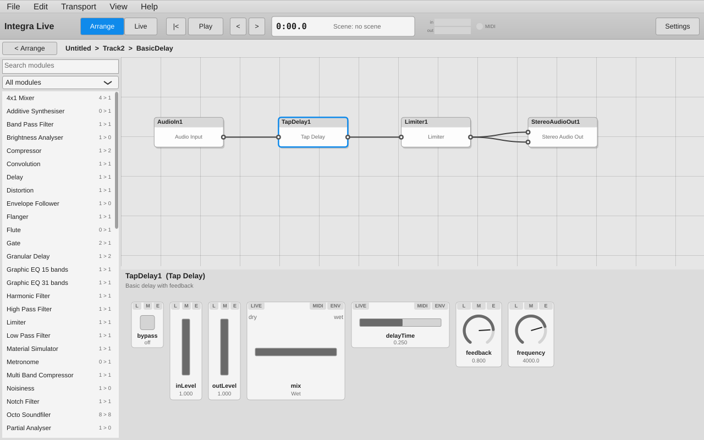

# Integra Live — JUCE port

A port of [Integra Live](https://github.com/BirminghamConservatoire/IntegraLive)
(Birmingham Conservatoire) — an application for interactive audio processing in
live performance — from its obsolete Flex/Adobe AIR front end to
[JUCE](https://juce.com), **keeping the original audio engine**: libIntegra and
its Pure Data (libpd) module library.



## What's here

```
libIntegra/        libIntegra 1.8.2 (from integra-framework) + tests, with portability fixes
                   and a new "host-driven audio" mode
third_party/       libpd 0.16.1 (Pd 0.56-5), Pd externals, flext, minizip, tmpfileplus
modules/           the 82 Integra modules (.module = interface definition + Pd patches)
blocks/            demo blocks
app/               the JUCE application (replaces the Flex GUI and integra_server)
docs/              the record of the port, step by step
reference/         the 2018 JUCE prototype from the integra2 branch (not built)
```

```
 ┌──────────────── JUCE app (single process) ────────────────┐
 │ Arrange / Module / Live views, widgets, properties, menus  │
 │ ProjectController (undoable ops) · ProjectModel · UserData │
 │ IntegraSession · NotificationHub · AudioHost               │
 └───────────────┬──────────────────────────────┬────────────┘
                 │ integra_api (in-process)      │ JUCE AudioDeviceManager callback
 ┌───────────────▼──────────────────────────────▼────────────┐
 │ libIntegra: node tree, commands, scenes, player, envelopes,│
 │ scalers, Lua scripting, MIDI (PortMidi), file I/O          │
 │ DSP engine ──▶ libpd (Pd 0.56-5) + externals ──▶ modules   │
 └────────────────────────────────────────────────────────────┘
```

Projects and blocks are **file-compatible** with Integra Live 1.x: the same
node conventions and the same `userData` XML are used, so the shipped demo
blocks open with their module layouts and live-view controls intact.

## Building (Linux)

```sh
sudo apt install build-essential cmake ninja-build pkg-config \
    libxml2-dev liblua5.2-dev libsndfile1-dev libfftw3-dev \
    portaudio19-dev libportmidi-dev libasound2-dev libjack-jackd2-dev libgtest-dev \
    libfreetype-dev libfontconfig1-dev libx11-dev libxrandr-dev libxinerama-dev libxcursor-dev libxext-dev
cmake -S . -B build -G Ninja
cmake --build build
ctest --test-dir build --output-on-failure      # GUI test needs xvfb-run (apt install xvfb xauth)
./build/app/IntegraLive_artefacts/RelWithDebInfo/integra-live --demo
```

JUCE 8 is fetched automatically. Lua 5.2, PortAudio, PortMidi and GoogleTest
are fetched if not installed. `cmake --install build` installs to
`<prefix>/lib/integra-live` with a launcher in `<prefix>/bin`; `cpack` makes a
tarball.

## Building (macOS)

```sh
brew install cmake ninja pkg-config libsndfile fftw portaudio portmidi googletest
cmake -S . -B build -G Ninja -DCMAKE_BUILD_TYPE=RelWithDebInfo
cmake --build build
ctest --test-dir build --output-on-failure
open "build/app/IntegraLive_artefacts/Integra Live.app"
```

## Building (Windows)

Visual Studio 2022 and [vcpkg](https://vcpkg.io); dependencies come from `vcpkg.json`:

```powershell
cmake -S . -B build -G "Visual Studio 17 2022" -A x64 `
      -DCMAKE_TOOLCHAIN_FILE="$env:VCPKG_ROOT/scripts/buildsystems/vcpkg.cmake" `
      -DVCPKG_TARGET_TRIPLET=x64-windows-static-md
cmake --build build --config RelWithDebInfo --parallel
ctest --test-dir build -C RelWithDebInfo --output-on-failure
```

Details in [docs/06-windows.md](docs/06-windows.md). CI builds and tests all three
platforms; the Windows job uploads a ready-to-run `integra-live-windows-x64` artifact.

To save Actions minutes (macOS minutes count 10x and Windows 2x on a private repository),
only the Linux job runs on every push and pull request. macOS, Windows and the sanitizer
job run once a day when the default branch had new commits, or on demand: Actions →
build → Run workflow (with "full" ticked).

## Tests

| Test | What it checks |
|---|---|
| `libIntegraTests` | the original libIntegra GoogleTest suite |
| `integra_smoke` | every module instantiates in Pd and answers pings; all demo blocks load |
| `integra_host_audio_test` | audio flows through libpd when driven by the host |
| `IntegraLive --self-test` | 76 end-to-end checks of the app core (undo, routing, envelopes, scenes, scripts, save/reload, Flex files, JUCE audio path) |
| `IntegraLive --gui-test` | 227 GUI interaction checks with synthesized mouse/keyboard events |
| `IntegraLive --stress-test [seconds] [projects...]` | every demo block opened, played, saved and reimported; every module's controls at extreme values; 600 random edits with undo/redo checks; long playback ([doc 09](docs/09-robustness.md)) |
| `IntegraLive --fingerprint-modules` | not a pass/fail test: each module's output and reported values for a fixed input, for comparing builds such as two Pd versions ([doc 10](docs/10-pd-upgrade.md)) |

All ctest suites also run in CI under AddressSanitizer + UndefinedBehaviorSanitizer
(`-DINTEGRA_SANITIZE=ON`, the `linux-sanitizers` job, daily or on demand).

## Documentation

1. [Analysis of the upstream repositories](docs/00-analysis.md)
2. [Importing the sources](docs/01-import.md)
3. [CMake build of libpd, externals and libIntegra](docs/02-build-system.md)
4. [The JUCE application core](docs/03-app-core.md)
5. [The JUCE user interface](docs/04-gui.md)
6. [Status, verification and next steps](docs/05-status.md)
7. [Windows (and macOS) build](docs/06-windows.md)
8. [macOS packaging and signing](docs/07-macos-packaging.md)
9. [Feature parity with the Flex GUI](docs/08-flex-parity.md)
10. [Robustness pass: stress test, sanitizers, crash fixes](docs/09-robustness.md)
11. [Upgrade to libpd 0.16.1 / Pd 0.56-5](docs/10-pd-upgrade.md)

## Licences

libIntegra and the Integra Live front end are GPL-2.0-or-later; the module
library is public domain (Unlicense); libpd is BSD-3-Clause; flext is
GPL-2.0-or-later. JUCE 8 is used under its AGPLv3 open-source licence, so the
combined application is distributed under the AGPLv3 (compatible with the
GPL-2.0-or-later components). The upstream Birmingham Conservatoire
repositories were only read; nothing was pushed to them.
