# 04 — The JUCE user interface

The Flex GUI (~76k lines of ActionScript/MXML) is replaced by a JUCE interface
under `app/Source/UI/` built on the core described in
[03-app-core.md](03-app-core.md). It keeps the original's three views and
workflow, reads and writes the same project files, and is exercised by an
automated interaction test.

## Views

### Arrange view — `ArrangeView.{h,cpp}` (Flex: `ArrangeView/`, `Timeline/`)

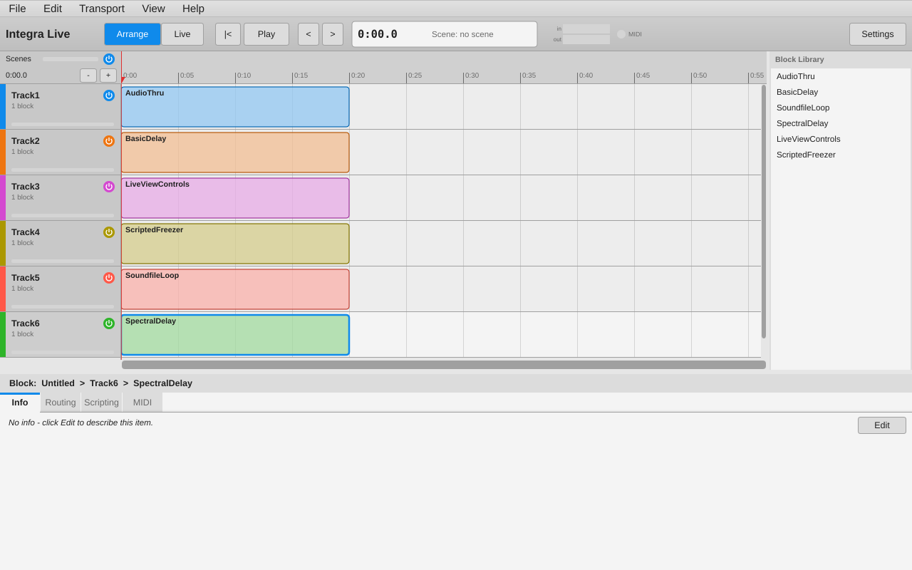

* **Timeline ruler** with time grid that adapts to zoom, **scene bar**,
  playhead (click/drag the ruler to locate; this deselects the scene, as in
  Flex), loop range. The strip along its top is Flex's zoom / scroll area:
  drag sideways to scroll and down / up to zoom in / out (15 px dead zone,
  zoom doubles every 50 px), about the clicked time; Shift locks one axis.
  It shows where the view is in the project.
* **Scenes** behave as in Flex (`Timeline.as`, `SceneBar.as`): drag in empty
  space to create one; each scene has a 10 px resize handle inside either edge
  (resize cursor) and moves when dragged in the middle (hand cursor). Edges snap
  to block starts/ends within 10 px, with snap lines drawn across the lanes;
  neighbouring scenes are pushed aside so scenes never overlap
  (`doSceneRescheduling`); the timeline auto-scrolls when dragging at its
  edges; the dragged scene is drawn in place while dragging. A drag, including
  the scenes it pushed, is one undo step. Double-click a scene to rename it in
  place. Right-click for mode (hold/play/loop), rename, key binding, delete;
  Backspace deletes the selected scene when the ruler has the keyboard focus
  and the scene is in view.
* **Tracks**: coloured headers (right-click: rename, *Change Track Colour...*,
  collapse, create block, height, move up/down, import block, import / export
  track, delete); "+ Add track", or double-click below the tracks (a click
  there shows the project). Double-click a track's name to rename it in
  place; drag the bottom edge of its header (grip in the corner) to resize it,
  or drag the header to move the track up or down. The **collapse button**
  left of the name (or a double-click elsewhere in the title row) shrinks the
  track to its title bar; its blocks are hidden and can't be dropped on
  (`arrangeViewExpanded` userData, undoable). *Change Track Colour...* (also in
  the Module View's menu) opens Flex's **colour wheel** at the mouse: press and
  drag on it to try colours on the track, release to set one (one undo step);
  a click outside closes it (`TrackColourPicker.{h,cpp}`). *Import Track...*
  adds a saved track (`.integra`, Flex `.tixd`) as the last track, with its
  envelopes connected to the player again; *Export Track...* saves the
  selected one (both also in the File menu).
  Each header has the track's **active button** (switches the track off and
  on, one undo step) and a **VU meter**; the project's are in the top-left
  corner (Flex: the active buttons and `AggregateVUContainer` in the title
  bars). A meter shows the latest level of any audio output module
  (AudioOut, StereoAudioOut, QuadAudioOut) inside the container. Inactive
  tracks, and everything when the project is off, are drawn grey
  (`ContainerControls.{h,cpp}`).
* **Blocks** positioned by their block envelopes: double-click an empty lane to
  add a 20-second block centred on the click (starting at the end of a block
  it would start in, and pushing later blocks along, as
  `ArrangeView.createBlock`); Ctrl+B adds one after the selected track's last
  block. Drag a block by its **name strip** to move it (also vertically to
  another track); drag either edge below the strip (10 px handles) to resize
  it; elsewhere a click only selects it (`BlockView.getDragInfo`; Flex's strip
  is at the bottom of the block, the port's at the top). Double-click to open
  it in the Module View (Ctrl+Shift+B), right-click for rename / export /
  delete / *Edit envelope*.
  Ctrl/Cmd-click selects several blocks: dragging one moves them all (keeping
  their time and track offsets), Delete removes them all. Double-click a
  block's name to rename it in place.
  Blocks don't overlap within a track: as in Flex (`doBlockRescheduling`), a
  dragged or resized block pushes its neighbours along, keeping their order;
  edges snap to blocks on other tracks and to scenes within 10 px; the whole
  drag is one undo step. Delete/Backspace removes the selected block (tracks
  are deleted from their context menu only).
* **Envelopes** inside blocks: all of a block's envelopes are drawn. Click an
  envelope's line (within 8 px) to select it, or choose it with *Edit
  envelope*; click the selected envelope's line to add a control point there
  and drag it; drag a point to move it (it stays between its neighbours and
  the first one stays at tick 0, as in `EnvelopeView.as`; the move is
  committed on release, with a "seconds, value" readout while dragging);
  double-click or right-click a point to delete it (not the first point). A
  block with several envelopes has an **envelope lock** button: when locked,
  clicks only reach the selected envelope (Shift inverts the lock). **Curve mode** (the curve button
  at the bottom right of the selected block, or *Curve mode* in its menu; stored
  in the block's `curvatureMode` userData as in Flex): drag a segment to bend it,
  double-click it to make it straight again. Curvature is drawn exactly as
  libIntegra interpolates it, `t^(2^-curvature)` (`EnvelopeView.drawCurvedTransition`).
* **Block Library** (right of the timeline, `BlockLibrary.{h,cpp}`, Flex
  `views/BlockLibrary/`): the shipped demo blocks in `index.xml` order, then
  the user's blocks saved with *Add to Block Library* (tinted). Drag a block
  onto a track (an outline shows where the new block will go, centred on the
  mouse, as `ArrangeViewTrack.onDragEnter`) or double-click it / press Enter
  to import it into the selected track at the playhead. A block dropped onto
  another starts at that block's end and later blocks are pushed along, so
  imports never overlap. `.integra` files dragged from the desktop onto a
  track are imported the same way. Right-click a user block to remove it from
  the library (it goes to the trash). Tooltips show the block's info text. The
  panel's width can be dragged (100–400 px) and is remembered.

  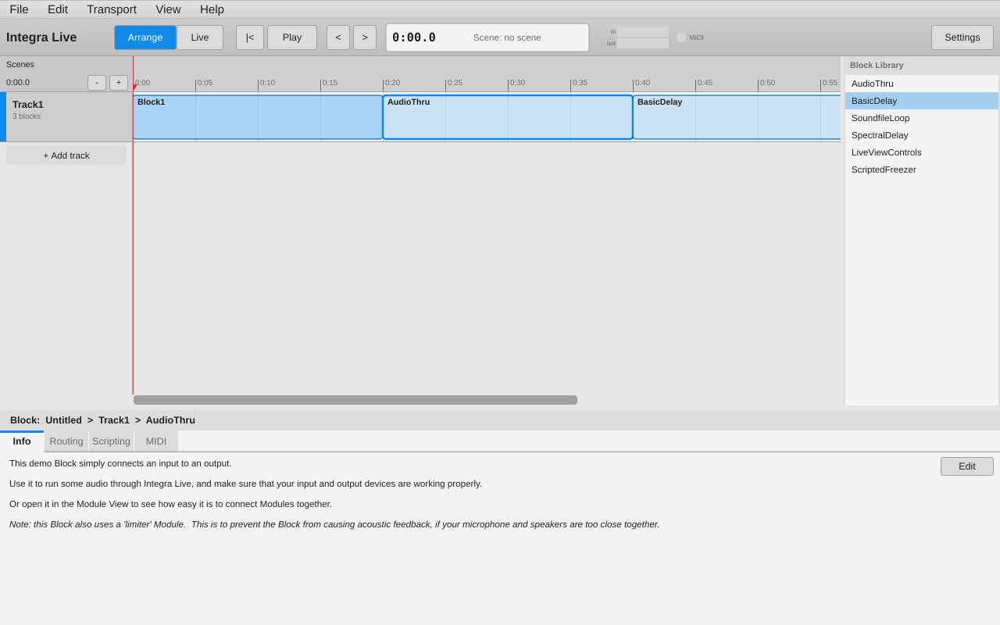
* Zoom with Ctrl+wheel or the +/- buttons, scroll with the scrollbar or
  shift+wheel; zoom/scroll persist in the project (`timelineZoom`,
  `timelineScroll` userData, same units as Flex).
* **Properties panel** (below, resizable) for the innermost selection
  (block → track → scene → project); double-click its title to rename the
  selection in place. The title's **breadcrumbs** (`Breadcrumbs.as`) link the
  project and track above it: clicking the project shows the project
  (deselecting track, block and scene), clicking the track deselects the
  block. A block's title bar has Flex's **envelope selection**
  (`BlockPropertiesTitlebar.as`): pick a module and one of its numeric
  attributes to select its envelope, or add one starting at the attribute's
  current value (attributes driven by a routing or MIDI are listed but
  disabled); x deletes the selected envelope.

  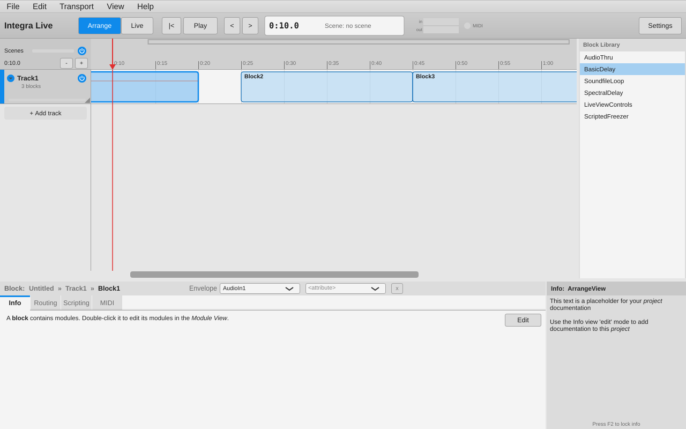 Clicking a scene in the scene bar shows
  the scene: its title bar has **State** (hold / play / loop), **Key** and
  **MIDI learn** for the scene (a MIDI input in the project routed to the
  scene's `activate`, as `ScenePropertiesTitlebar.as`), and an Info tab. The
  project's title bar has MIDI learn for **Prev Scene** and **Next Scene**
  (`ProjectPropertiesTitlebar.as`). Learn adds a MIDI input that waits for a
  controller; clicking Learn again while it waits cancels it, and x removes
  a learned assignment. Tabs:

  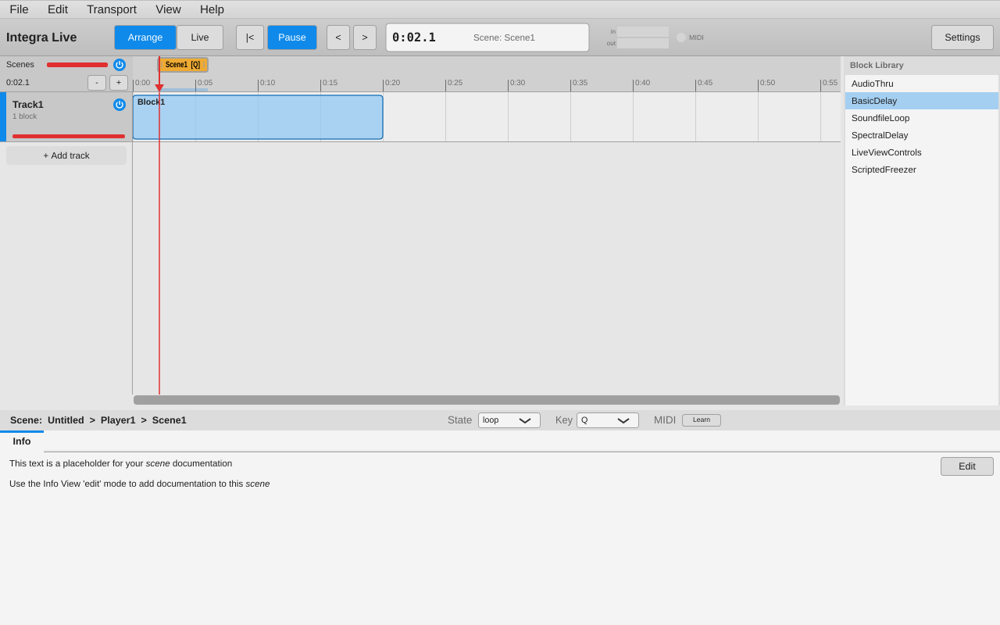

  * *Info* – Markdown rendering of the `info` endpoint with an editor
  * *Routing* – scaled connections (`Connection → Scaler → Connection`):
    source / target endpoint pickers, input & output ranges and scale types
  * *Scripting* – Lua script list, editor with Lua syntax highlighting, Run
    (Ctrl/Cmd+E, also from the editor)
  * *MIDI* – MIDI control inputs: device, channel, CC/note, number, learn,
    target

### Module View — `ModuleView.{h,cpp}`, `ModuleProperties.{h,cpp}` (Flex: `ModuleGraph/`, `ModuleLibrary/`, `ModuleProperties/`)

* **Module library** (right of the graph, as in Flex's `ModuleLibrary.as`):
  every module with audio endpoints, including embedded and in-development
  ones, one line per module showing its best version, sorted in-development /
  shipped / 3rd party / embedded, then by label; 3rd party, embedded and
  in-development lines are tinted. A module with several loaded versions has an
  expander (click the triangle, or Left/Right) listing them under *LATEST
  OFFICIAL* / *THIRD PARTY* / *EMBEDDED* / *IN DEVELOPMENT* headings, so a
  specific version can be added. The search box matches labels (with a clear
  button); the tag cloud below, sorted by how many modules use each tag,
  filters on all selected tags; searching clears the tags and selecting a tag
  clears the search, as in Flex. Drag a module onto the graph, double-click it
  or press Enter to add it. Tooltips show Flex's info text (source, modified
  date and author for version lines). Drag the "Tags..." strip to resize the
  tag cloud.

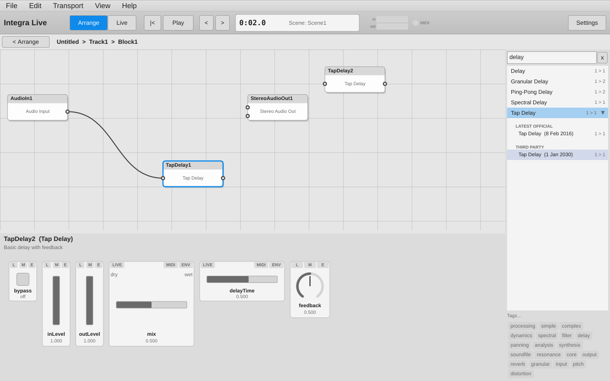
* **Title bar**: the block's active button and VU meter, right of the
  breadcrumbs (Flex: the module graph's title bar).
* **Module graph**: modules at their stored grid positions (Flex grid units,
  one unit = one text row = 18 px), audio pins on each side; drag a module to
  move it (half-unit snapping), drag from an output pin to an input pin (or
  back) to connect (links from a module to itself or that would create a
  feedback loop are refused, as `IntegraModel.canSetAudioLink`), click a
  connection to select it (selecting a module selects its connections too; Delete
  removes the selected modules and connections in one undo step). A dragged
  module snaps to other modules' edges within 10 px, with snap lines. The tick at
  a module's top right puts all of its controls in the Live view, or takes them
  out. Right-click empty space for Remove Selection, Import / Export Module and
  Change Track Colour. Dragging a module in from the library shows it half
  transparent where it would go; dropped onto a connection it is spliced in
  (the connection's source feeds its first audio input, its first audio output
  feeds the connection's target; one undo step), as Flex's
  `ModuleGraph.onDragDrop`. Delete removes the
  selection, right-click a module to rename / export / delete. Double-click a
  module's name to rename it in place. Ctrl/Cmd-click or drag a rubber band on
  empty space to select several modules; dragging one moves them all, Delete
  removes them all. The selected
  module is saved as the block's `primarySelectedChild`, as in Flex.
* **Module properties**: the module's widgets from its interface definition,
  at their design positions. Each widget has three toggles:
  **LIVE** (show in Live view), **MIDI** (create a MIDI control input in learn
  mode, routed through a scaler), **ENV** (add/remove a block envelope for that
  control). Double-click a control's value to type a new one (Enter sets it,
  Escape cancels; numbers are clamped to the range, enumerations accept their
  names), as Flex's `AttributeLabel`. Right-click a control for *Revert to
  default* > that control, or *All Controls* of the module (one undo step;
  locked controls are left alone). Double-click the title to rename the module.
  Controls with several values (XY pads, range sliders) have a value to type
  for each; MIDI learn on them asks which value to learn. Values are quantised
  to allowed values and integers. Click a number box to type; a range slider
  moves an end, both ends (drag the middle), or draws a new range, and a
  double-click on its middle swaps the ends; knobs turn with a 200 px vertical
  drag.

  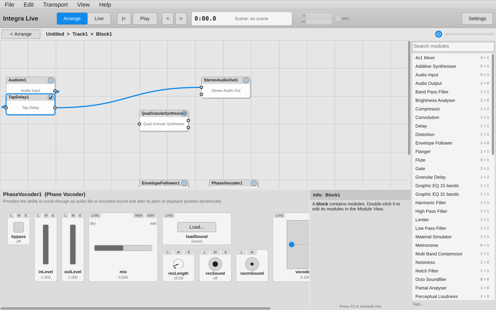

Dark colour scheme (per project, as in Flex; Settings → Dark colour scheme):

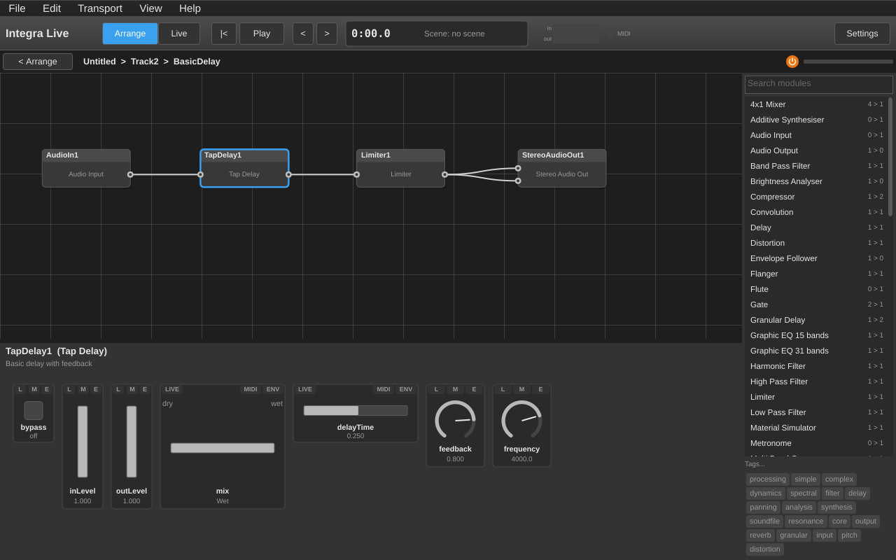

### Live view — `LiveView.{h,cpp}` (Flex: `LiveView/`)

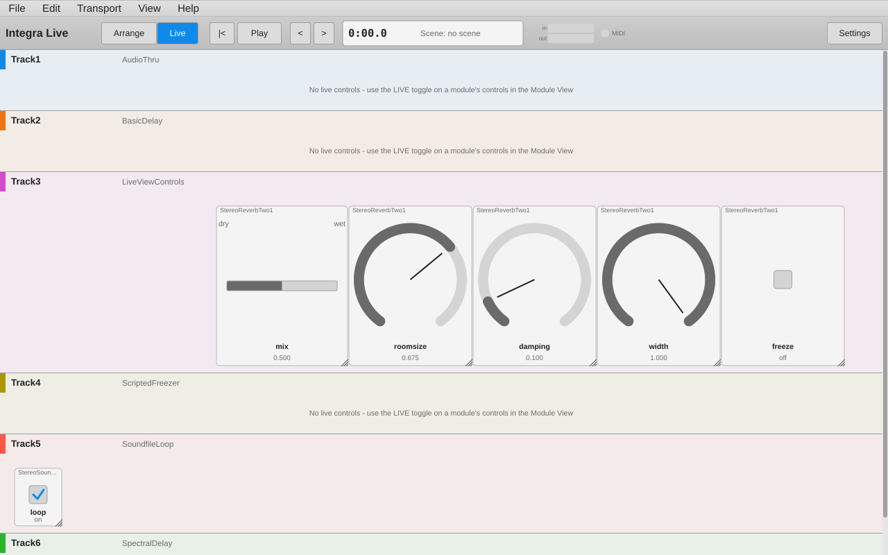

Each track shows the live-view controls of the block currently under the
playhead (nothing when no block is, as in Flex), with the track's active
button and VU meter in its header; the project's are at the top right.
Controls appear where they were placed — the demo block *LiveViewControls*
above was laid out in the Flex GUI and opens unchanged. Drag a control's
title strip to move it and any edge or corner to resize it; edges snap to
the other controls' edges within 10 px, with snap lines, and controls stay
inside the block area (`LiveViewBlock.as`). Right-click the block area for a
menu of each module's controls (ticked when shown): choosing one adds it at
the click point, or removes it. The layout is stored in the block's
`userData` relative to the block area, as Flex stored it.

Scene buttons across the top select scenes, and each scene's key binding
(0-9 or A-Z, stored upper-case as in Flex) works anywhere in the window while
the Live view is shown, except in text fields. **Scene Shortcuts**
(`KeybindingView.{h,cpp}`, Flex `KeybindingView.as`) is an on-screen keyboard
below: keys show their scene, the current scene's key is highlighted,
clicking a key selects its scene and dragging a scene's key onto a free key
rebinds it. Its title bar collapses it (click the arrow) or resizes it
(drag, 100–400 px); both are remembered.

The view is rebuilt only when something it shows changes (tracks, the block
under the playhead, its modules or live controls, scenes), and never while a
mouse button is down in it, so model changes no longer interrupt a drag.

### Module Manager — `ModuleManager.{h,cpp}` (Flex: `ModuleManager/`, `UpgradeDialog.as`)

View › Module Manager... (Ctrl/Cmd+4), as in Flex, with two tabs:

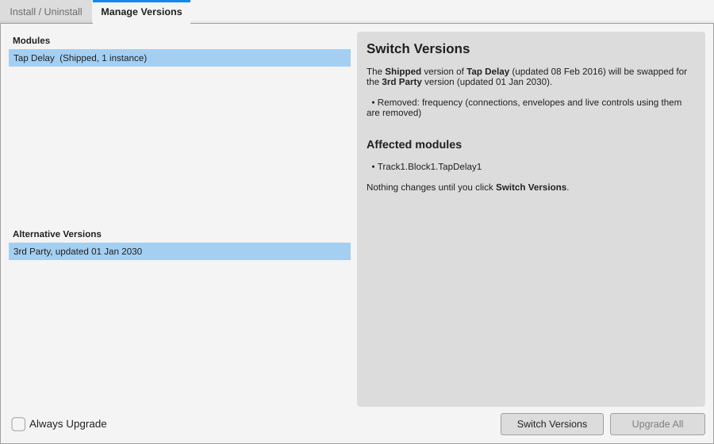

* **Manage Versions**: the modules in the project that have other versions
  loaded (shipped, 3rd party or embedded in the project), their alternative
  versions (the *Latest Official* one marked), and a report of what switching
  would change: endpoints added, removed or changed, and the affected modules.
  **Switch Versions** replaces every instance of the selected version, as
  Flex's `SwitchModuleVersion` did: the module is recreated under the same name,
  its values are carried over and fitted to the new version's ranges and allowed
  values, connections, routings and envelopes to endpoints that no longer exist
  are removed (the others stay), and live view controls whose widget is gone are
  removed. **Upgrade All** switches every module to its latest official version
  (shipped before 3rd party before embedded, newest first), saving a backup of
  the project first. Both are one undo step. **Always Upgrade** is stored in the
  application settings.

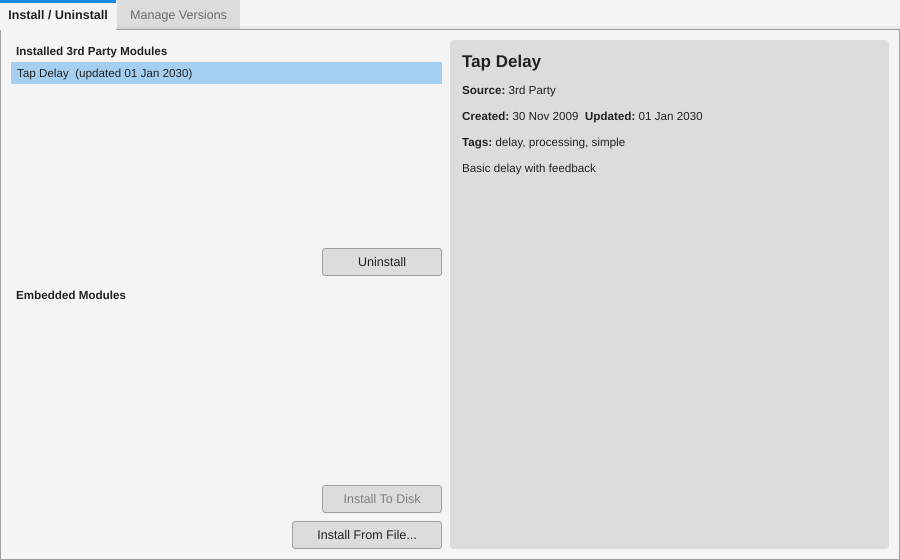

* **Install / Uninstall**: installed 3rd party modules (Uninstall: modules in use
  are either deleted or kept embedded in the project, as Flex asked), modules
  embedded in the project (Install To Disk), Install From File..., and an info
  panel for the selected module.

After a project is opened or a module is installed, if any module in the
project isn't its latest official version, the **Upgrade Modules** dialog lists
them and offers *Don't Upgrade*, *Module Manager...*, *Upgrade* and *Always
Upgrade* (with Always Upgrade set, they're upgraded straight away). Upgrades and
installs end with a report window.

## Widgets — `Widgets/IntegraWidgets.{h,cpp}` (Flex: `controls/`, `controlSDK/`)

All 18 widget types found in the module library are implemented and bound to
endpoints through their IID attribute mappings:

| Widget | Attributes | Notes |
|---|---|---|
| Slider, Knob, NumberBox | value | linear / exponential / decibel scaling via the endpoint's value scale (same maths as `ControlScaler.as`); double-click resets to default |
| Checkbox | value | toggles between range minimum and maximum |
| Trigger, StopButton | value (bang) | |
| PlayButton, RecButton | value | toggle |
| RadioGroup | value | from allowed states / state labels / small integer ranges |
| RangeSlider | min, max | two-thumb slider |
| VuMeter | level | follows Pd feedback |
| SoundFileLoadDialog, FileLoadDialog, FileSaveDialog, LocateFolderDialog | value | native file / folder chooser |
| XYPanPad, XYScratchPad | x, y | 2-D pad |
| DryWetBalance, EarlyLateBalance, PanoramaBalance | value | labelled crossfader |

Every widget follows its endpoints through `EndpointWatcher` (a per-path
registry on top of the notification hub), so values changed by envelopes,
scripts, MIDI, routing or Pd feedback update the controls; user edits go
through `ProjectController` and are undoable (drags coalesce into one step).

A control whose endpoint is driven by an envelope, MIDI (once learned) or a
routing is locked, as in Flex's `ControlContainer`: it shows a padlock and the
user can't change it (for a multi-endpoint widget, only the driven attribute is
locked). Clicking the padlock offers *Delete Envelope* / *Delete Routing from
…* for each driver (`model::Project::driversOf`).

## Application shell — `MainComponent`, `RibbonBar`, `PreferencesPanel`

* **Ribbon**: Arrange/Live switch, return-to-start, play/pause, previous/next
  scene, time and current scene display, input/output level meters, MIDI
  activity light, Settings.
* **Menus & keys**: File (New, Open, Save, Save As, Import/Export Block,
  Import/Export Track, Install Third-Party Module), Edit (Undo/Redo with descriptions, Delete, Add
  Track, Delete Track Ctrl+Shift+T, Create Block Ctrl+B, Add Scene), Transport (Space play/pause, Enter or Home to return to
  the start, ←/→ or Ctrl+←/→ for scenes, as Flex's `onStageKeyDown`), View
  (Ctrl+1/2 for Arrange/Live, Module View, Info View Ctrl+3, Lock Info View F2
  — Ctrl+3 on macOS —, Module Manager, Lighting Ctrl+L, High Contrast Ctrl+H,
  Text Size Ctrl+= / Ctrl+- / Ctrl+0, Settings), Help (Integra Live Website,
  Open Demo Project, About). Unsaved-changes prompts on New/Open/Quit. Ribbon
  buttons don't take the keyboard focus, so these keys work anywhere outside
  text fields.
* **Info view** — `InfoView.{h,cpp}` (Flex: `views/InfoView/`): help for
  whatever is under the mouse, refreshed 8 times a second. Components that
  have help implement `InfoProvider::getInfoAt`; the texts are Flex's
  `assets/viewInfo/*.md` (copied to `viewInfo/` next to the executable), with
  `<!-- mac only -->` / `<!-- windows only -->` spans kept per platform, and
  the project's own `info` for blocks, tracks, scenes and modules (module
  controls show each attribute's description). F2 locks it (scroll, and Edit
  for a node's info); it sits beside the properties, or beside Scene Shortcuts
  in the Live view. Shown / hidden state, text size and the last project folder
  are user settings.

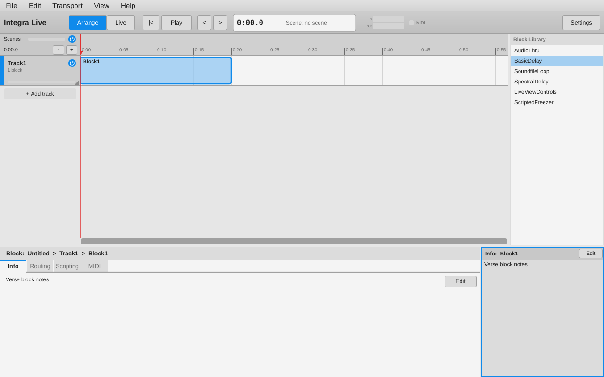
* **High contrast and text size**: High Contrast doubles the distance of every
  theme colour from the background (stored in the project, as Flex did); text
  size scales the window in five steps (0.75 to 1.5).
* **Files** (Flex `IntegraLive.mxml`): Open starts in the current project's
  folder (else the last folder used) and accepts `.integra` projects and bare
  `.ixd` files; Save As names the project after the file (the name loses
  characters Integra doesn't allow and leading digits) and always writes
  `.integra`; *Install Third-Party Module* takes several `.module` files and
  `.bundle` files (zips of modules); `.module` / `.bundle` files given on the
  command line or opened from the desktop are installed rather than opened. A
  "Loading: name..." message covers the window while a project loads (also
  "Starting new Project..." and for the demo project).
* **Settings**: JUCE's audio device selector (ALSA/JACK on Linux, CoreAudio,
  WASAPI/ASIO on Windows) — the device the libpd engine runs on; MIDI
  input/output devices through libIntegra's `MidiSettings` module (PortMidi);
  colour scheme.

## Command-line options

| Option | Purpose |
|---|---|
| `<file.integra>` | open a project |
| `--demo` | start with the demo project (every block from `blocks/` on its own track) |
| `--self-test` | headless core test (doc 03) |
| `--gui-test` | GUI interaction test (needs a display; CTest runs it under `xvfb-run`) |
| `--screenshot <png> [--view arrange\|live\|module] [--select <path>] [--scheme light\|dark]` | render the window to a PNG and quit (used for these docs) |
| `--quiet` | silence libIntegra's error trace |

## GUI interaction test

`IntegraLive --gui-test` drives the real components with synthesized mouse and
keyboard events and checks the resulting project state (214 checks, all
passing), including: double-click to add a block, drag to move, edge-drag to
resize, overlap prevention, add track, drag a block to another track, drag in
the scene bar to create a scene, click the ruler to move the playhead,
Edit › Undo/Redo, extending and shortening a scene from either edge, a
scene pushing its neighbour along (undone in one step), a scene edge snapping
to a block edge, double-click to open the Module View, drop a module from
the library at a grid position, patch output→input pins, drag a module and
persist its position, the module's 7 widgets appear, moving a knob sets the
endpoint and the knob follows external changes, LIVE and ENV toggles, the
Live view shows the control of the playing block, scene key binding,
Delete key removes a module together with its envelope and live control, and
one undo restores all of it; the module library's version expander, headings,
search and tag filters, and Enter to add a specific version; dragging blocks
from the Block Library onto a track, imports pushing later blocks along (one
undo), and adding / removing user blocks; track and project active buttons,
track and project meters following a test tone, the block's active button in
the Module View; scene properties (State, Key, MIDI learn and its removal),
project Next Scene MIDI learn; Scene Shortcuts (select, drag to rebind,
collapse); the Live view's track active button, not rebuilding on unrelated
changes, adding a control at the right-clicked point, snapping, resizing from
the left edge and removing a control; typing values (Enter, clamping,
Escape), Revert to default for a control and for all controls (one undo
step), right-clicking a slider without moving it; in-place renames of modules
(graph and controls title), scenes, blocks, tracks and the properties title,
dropping invalid names; resizing and moving tracks by dragging; Ctrl/Cmd-click
multi-selection of blocks with a group drag and delete; rubber-band selection
of modules with a group drag and delete; clicking an envelope line to select
it and to add a point, double-clicking a point to delete it, and the envelope
lock button; the Info view (texts loaded, block and ribbon help under the
mouse, Ctrl+3, F2 lock, editing a block's info), Lighting, High Contrast and
Text Size, plain arrow keys and Enter, and splicing a module into a
connection (preview, wiring, one undo); collapsing tracks (button and title
bar, hidden blocks, undo), the colour wheel (one undo step), new blocks
centred on a double-click pushing later ones, Ctrl+B, clicking and
double-clicking below the tracks, Ctrl+Shift+T, exporting and importing a
track (last, selected, envelopes driven, undo, block files refused), the
ruler's zoom / scroll strip (zoom about the click, Shift for scrolling only),
Backspace on a scene, the breadcrumbs, adding and deleting an envelope from
the block title bar, and Ctrl+E in the script editor; module graph connection selection with
modules, Delete and undo, the rubber band, edge snapping, the Live View tick,
Import Module, the tag cloud's size, range slider gestures, number boxes,
typing an XY pad's y, and value quantising.

Bugs it found and that are fixed:

* `ProjectController` methods took `const String&` paths that often referred
  into the model snapshot, which the same method then rebuilt — a
  use-after-free. Controller methods now take paths by value.
* Live-view key bindings ignored key events that carry only a key code.
* The properties panel looked for scenes under the project; they live under
  the Player.
* (test harness) JUCE's Linux run loop can lose a quit message posted from
  inside a pumped callback; the test quits from a fresh timer dispatch.

## Not (yet) ported from the Flex GUI

A full feature-by-feature comparison with the Flex GUI is in
[08-flex-parity.md](08-flex-parity.md).

* Track collapsing.
* Crash reporter, update checker.
