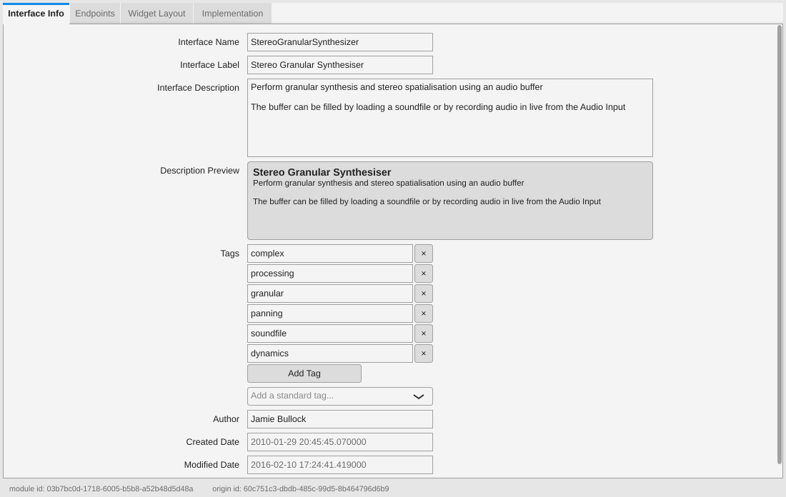
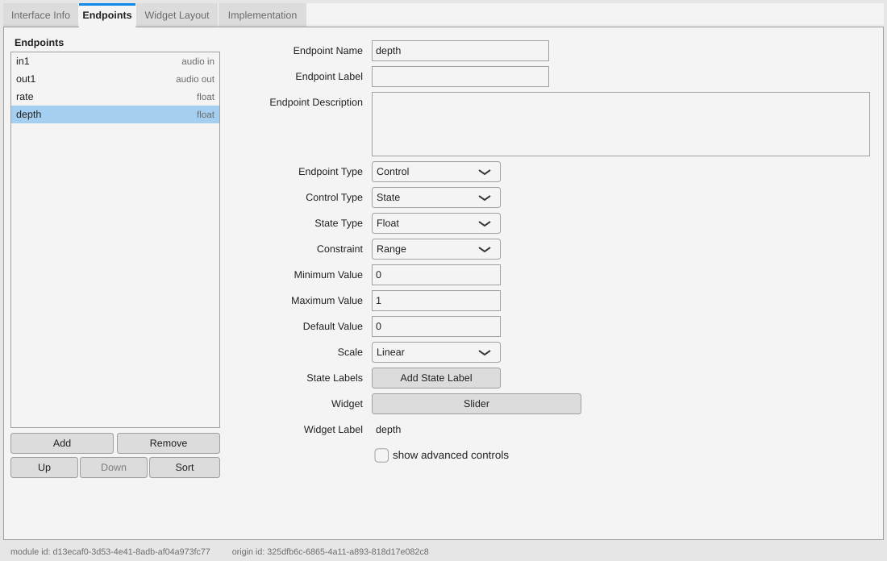
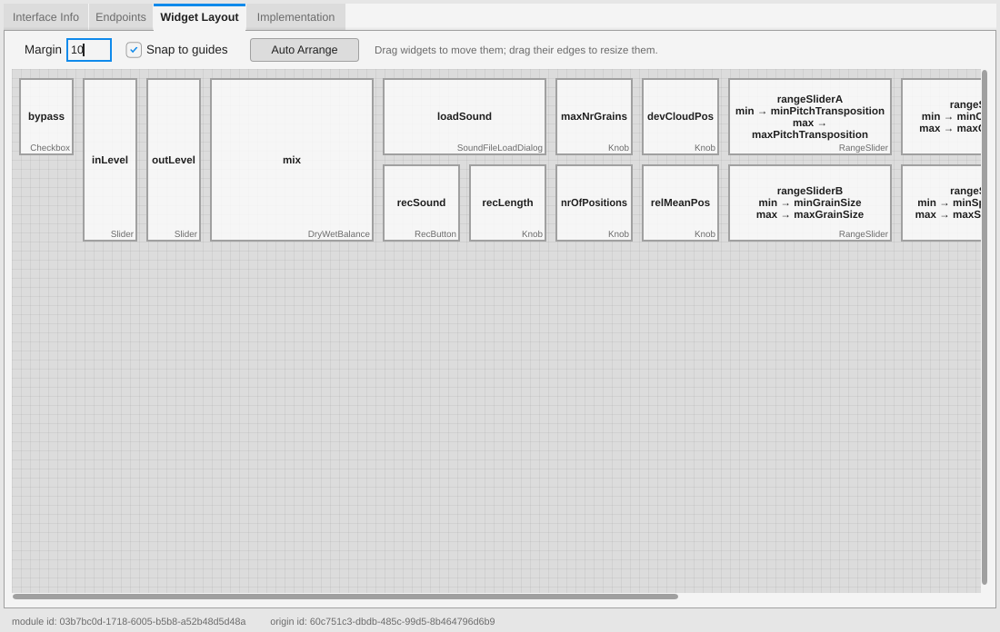
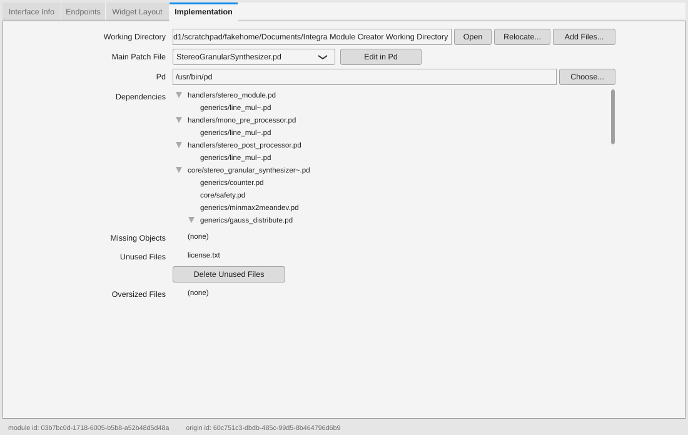

# 12 — The Integra Module Creator

Integra Live 1.x came with a companion application, the **Integra Module Creator**
(part of the *Integra Module Developer SDK*, `SDK/ModuleCreator` in the
[original repository](https://github.com/BirminghamConservatoire/IntegraLive/tree/develop/SDK)),
for making third-party modules. Like the old Integra Live GUI it was written in
Flex/ActionScript for Adobe AIR, so it no longer runs. It was not part of the
first rounds of this port ([01-import.md](01-import.md) left "the SDK and the
module-creator tooling" out); this step ports it to JUCE, as a second
application built from this repository: `module-creator/`.



## Using it

A module is a `.module` file: a zip holding an **interface definition**
(`integra_module_data/interface_definition.iid`: the module's name, its
endpoints, and the widgets Integra Live shows for them) and an **implementation**
(Pure Data patches under `integra_module_data/implementation/`). The Module
Creator edits both. Its four tabs are the original's:

| Tab | What you do there |
|---|---|
| **Interface Info** | Name (UpperCamelCase), label, description (Markdown, with a preview), tags (pick standard ones or type your own), author. Created and modified dates are kept for you. |
| **Endpoints** | The module's inputs and outputs. *Stream* endpoints are audio inputs and outputs. *Control* endpoints are *bangs* or *states* (float, integer or string) with a range or a set of allowed values, a default, a scale (linear, exponential, decibel) and optional labels for particular values. Each control can get a widget; widgets with two attributes (XY pads, range sliders) can be shared by two endpoints. "Show advanced controls" exposes *Is Saved To File*, *Is Input File*, *Can Be Source* and *Can Be Target*. **Sort** orders streams first, then controls in the left-to-right order of their widgets. |
| **Widget Layout** | Drag widgets to arrange them as they will appear in Integra Live's module properties; drag their edges to resize them (within each widget type's limits). Edges snap to the other widgets, and to a margin beside them; **Auto Arrange** lines them up. |
| **Implementation** | The *working directory* holds the module's patches while you edit them. Put your patches and abstractions there (**Add Files...** copies them in; **Open** shows the folder), choose the **main patch**, and press **Edit in Pd**: Pd opens the main patch inside a test host that feeds it audio from your audio interface, plays its outputs, and has a box for every endpoint so you can try values. The tab lists the abstractions the patch uses, Pd objects that can't be found (these stop the module from being saved), unused files (which can be deleted) and files of 1 MB or more. |



The menus:

* **File** — New; **Import Template** (start from one of the SDK's templates:
  analysers, generators, and mono, stereo and multichannel processors, each with
  its endpoints, widgets and a working patch — or from any other module with
  *Browse...*); Open; Save; Save As.
* **Test** — **Test in Integra Live** saves the module to a temporary file and
  hands it to Integra Live (starting it, or passing it to the copy already
  running), which loads it as the *in-development* module: it appears in the
  module library under "In Development", and testing again replaces it (and
  offers to upgrade instances of the previous version). **Edit Implementation in
  Pd**; **Locate Integra Live...** if it isn't found next to the Module Creator.
* **Module Bundles** — pack several modules into one `.bundle` file, which
  Integra Live installs in one go, or extract the modules of a bundle.
* **Help** — this guide, Pure Data's website, the original repository, the SDK
  licence agreement and the About box.

Problems are listed in red on the tab they concern as you edit (and the endpoint
list marks endpoints that have them). Saving and testing refuse a module with
problems and show the first one. The checks are the original's: names and their
case, unique endpoint names, the reserved names (`init`, `fini`, `ping`, and
`dataDirectory` unless it is a string that isn't saved, isn't a target and is
sent to the host), values that fit the type, defaults and labels inside the
range or among the allowed values, no duplicate allowed values or labels,
exponential scales only over positive ranges, input-file endpoints only with a
`dataDirectory` endpoint, labels for shared widgets, at least one endpoint and at
least one audio stream, and no missing Pd objects.



### Needed: Pure Data, for editing implementations

Integra Live runs modules in its built-in copy of Pd (libpd), but editing a patch
needs the Pd application: install [Pure Data](https://puredata.info) (vanilla).
The Module Creator looks for it in the usual places (`/Applications/Pd*.app`,
`Program Files\Pd`, `pd` on the `PATH`); **Choose...** on the Implementation tab
picks another. Patches can use Pd vanilla's objects (including `bonk~`, `fiddle~`
and `expr`) and the externals Integra Live has built in (`partconv~`,
`freeverb~`, `fsplay~`, `soundfile_info`, `copy`); the lists are
`supported_pd_externals.txt` and `pd_internal_objects.txt` in the resources
folder. A desktop Pd has the vanilla objects but not those externals, so a patch
using them shows "couldn't create" in Pd while still working in Integra Live.



### The working directory

The implementation lives in a folder called *Integra Module Creator Working
Directory* (in your Documents folder; **Relocate...** moves it). It is emptied
whenever a module is created or opened, so the Module Creator marks it with a
hidden `.integra-module-creator` file and never uses a folder of that name that
holds other files (it picks "... Working Directory 2" instead). Changes made in
Pd or the file browser are noticed within two seconds.

### Licence

As with the original SDK, modules made with the Module Creator are dedicated to
the public domain: every `.module` file it saves contains the
[Unlicense](http://unlicense.org/) (`integra_module_data/license.txt`), and the
licence agreement is shown on first start (Help > License Agreement).

### Command line

```
integra-module-creator [file.module]      open a module
integra-module-creator --developer        libIntegra developer mode (as the config file's <integradeveloper/>):
                                          allows the 'core' tag, "Implemented in libIntegra" and "Is Sent To Host"
integra-module-creator --self-test [modules folder]
integra-module-creator --gui-test
integra-module-creator --screenshots <folder> [file.module]
```

## How it was ported

| Flex (`SDK/ModuleCreator/src`) | JUCE (`module-creator/Source`) |
|---|---|
| `ModuleCreator.mxml` (window, menus, load/save, validation report, test, license) | `UI/MainComponent`, `Main.cpp`, `Core/Document` |
| The XML each control kept itself (`InterfaceInfo`, `Endpoint`, `ControlInfo`, `StateInfo`, `Range`, `AllowedValues`, `Scale`, `StateLabels`, `StreamInfo`, `WidgetLayoutElement`, `*.saveToXML/loadFromXML/validateContent`) | `Core/ModuleDefinition`: one plain data model with `fromXml`, `toXml` and `validate`, kept apart from the UI |
| `InterfaceInfo.mxml`, `MarkdownPreviewPanel.mxml`, `TagList`/`TagEditor` | `UI/InterfaceInfoPage` (the preview is shown inline, with Integra Live's own Markdown renderer) |
| `EndpointList.mxml` (accordion of `Endpoint`s), `WidgetSelection.mxml` (widget tree) | `UI/EndpointsPage` (list + editor; the widget tree became a menu: widget ▸ attribute ▸ share with ... / use separate widget) |
| `WidgetLayout.mxml`, `WidgetLayoutElement.mxml`, `SnapLine`, `CursorSetter`, `MouseCapture` | `UI/WidgetLayoutPage` |
| `Implementation.mxml` (working directory, dependency trees, polling) | `UI/ImplementationPage`, `Core/Implementation` (`ImplementationScan`) |
| `HostStarter.as`, `assets/host/*` | `Core/PdHost`, `HostPatch` in `Core/Implementation`, `Resources/host/*` (unchanged) |
| `TestInIntegraLiveProcess.as` | `MainComponent::testInIntegraLiveNow` + Integra Live's new in-development loading (below) |
| `BundleMaker.as` (FZip) | `Core/ModuleFile` (`juce::ZipFile`) |
| `Config.as`, `assets/ModuleCreator_config.xml` | `Core/CreatorConfig`, `Resources/ModuleCreator_config.xml` |
| `LicenseDialog.mxml`, `AboutBox.mxml`, `assets/agreement.md`, `assets/license.txt` | `MarkdownPanel` in `MainComponent.cpp`, `Resources/` (unchanged) |
| `DirectoryStore.as` (SharedObject) | the settings file (`juce::ApplicationProperties`) |
| `SDK/templates/` | `Resources/templates/` (unchanged) |

Files are written exactly as the Flex version wrote them: same elements in the
same order, the same `<?xml version="1.0" ?>` header, dates as
`2016-02-10 16:34:35.572000`, a new module id on every edit (so Integra Live
treats each saved version as a new version of the same *origin*), the licence in
every module.

What changed, and why:

* **Integra Live had to learn "in-development" modules.** The Flex Integra Live
  recognised the file name `ModuleInDevelopment-4df2725b-….module` and called
  libIntegra's `load_module_in_development` instead of installing it; the JUCE
  port had only the install path. `ProjectController::installModule` now does
  the same, so *Test in Integra Live* can be repeated without filling the
  third-party module folder with versions (`IntegraLive --self-test` checks it).
* **Bundles are always available.** The Flex version hid the Module Bundles menu
  behind an "easter egg" config tag; Integra Live installs bundles, so the
  Module Creator now always makes them.
* **New endpoints get valid names** (`newEndpoint1`, not `<New Endpoint #1>`), and
  ranges start at 0..1 with default 0 rather than empty, so a new endpoint is
  valid until edited.
* **Problems are shown inline** in red on each tab instead of in tooltips on
  red-outlined fields, as well as in the report when saving.
* **The working directory is protected** by a marker file (above); the Flex
  version would empty any folder named "Integra Module Creator" in Documents.
* **Implementation additions:** *Add Files...*, a choice of Pd application, and
  polling every 2 s rather than 10 s.
* **Unsafe zips are refused**: a module whose implementation has `../` paths
  is not extracted.
* **Dropped:** the example widgets (`ExampleBalance`, `ExampleFileLoadDialog`)
  that only the Flex GUI's widget SDK had; the dead integralive.org help links;
  the AIR code-signing certificate.

### Verification

* `integra-module-creator --self-test` (48 checks): every one of the 82 shipped
  modules loads, validates (in developer mode, as they use the `core` tag) and
  saves to an interface definition identical to the original, element by
  element, with byte-identical implementation files; each of the 9 templates
  imports with only its name missing; a module built from scratch exercises the
  validation rules, shared widgets, sorting, auto-arrange, dependency scanning
  (abstractions, a missing object, an unused file, a circular reference), the Pd
  host patch, save and reopen, bundles, and refusing an unsafe zip.
* `ModuleCreator_saved_modules_load_in_libIntegra`: libIntegra's smoke test
  instantiates every module the self test saved — the 82 re-saved shipped
  modules and one new module made from each template — in libpd and pings them
  (two of the shipped modules don't answer the ping, exactly as when the smoke
  test runs on the original library; the nine new ones all do).
* `integra-module-creator --gui-test` (22 checks, under xvfb on Linux): typing in
  the real fields a key at a time (each key edits the module, and the field must
  keep the keyboard focus), adding and editing endpoints, the validation shown
  per endpoint, dragging, resizing and snapping widgets, picking up a patch put
  in the working directory, the validation report switching tabs, save and
  reopen, the File menu (templates, Quit) and importing a template. (Choosing a widget goes through
  a popup menu, which the test can't drive; it assigns the widget directly.)
* By hand: the host patch generated for a template opens in Pd 0.54 (Ubuntu's
  `puredata`) without errors, with the module, the audio connections and the
  parameter boxes; the self test, the GUI test and `--screenshots` on a large
  module pass under AddressSanitizer + UndefinedBehaviorSanitizer
  (`-DINTEGRA_SANITIZE=ON`; CI's sanitizer job runs the ctest suite this way).

### Packages

The packages CI makes include the Module Creator next to Integra Live, so each
finds the other: the Linux tarball (`bin/integra-module-creator`), the macOS
DMG (both apps, signed the same way, to drag into Applications; the Module
Creator gets no audio-input entitlement as it needs none) and the Windows
artifact (`Integra Module Creator.exe` and its `module-creator-resources`
folder in the Integra Live folder). The macOS job also checks the Module
Creator is universal and links nothing outside the OS.

Not yet verified: the Module Creator has only been built and run on Linux. It
uses nothing platform specific beyond JUCE and is built by the same CMake on
macOS and Windows, but the macOS and Windows packaging changes haven't been run
in CI yet, and *Edit in Pd* / *Test in Integra Live* haven't been tried there.
